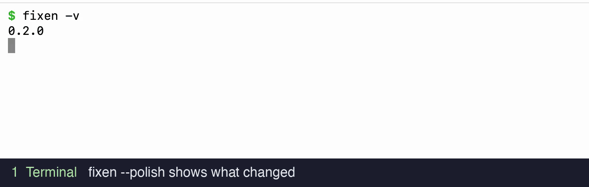

# fixen

**이미 쓰고 있는 LLM으로, 명령줄에서 영어(또는 어떤 언어든) 문장을 고칩니다.**

[](https://www.npmjs.com/package/fixen-cli)
[](https://github.com/Heoooooon/fixen/actions/workflows/ci.yml)
[](LICENSE)


[English](README.md) | [简体中文](README.zh-CN.md) | [日本語](README.ja.md) | **한국어**

<p align="center">
  
</p>

<p align="center"><sub>fixen 0.2.0 실제 녹화(모델 대기 시간은 잘라냄) · <a href="docs/assets/demo.mp4">MP4 버전</a></sub></p>

## 빠른 시작

```sh
npm install -g fixen-cli    # `fixen` 명령 설치 (Node.js ≥ 18)
fixen doctor                # 백엔드, 저장소, 클립보드, 알림 점검
```

바로 써 볼 수 있습니다:

```sh
fixen "I has a apple"                                 # → I have an apple.
fixen -e -l Korean "She go to school yesterday"       # 고친 이유도 한국어로 설명
fixen -t Japanese "私は昨日学校に行きたです"            # 영어뿐 아니라 어떤 언어든 교정
```

[백엔드](#백엔드-고르기)가 하나 이상 필요합니다. 터미널에서 `claude`, `codex`, `gjc`, `gemini`, `ollama` 중 하나라도 실행된다면 준비는 끝났습니다.

## 세 가지 사용법

### 1. 터미널에서

```sh
fixen "your english sentence"       # 한 번 실행
echo "your sentence" | fixen        # stdin / 파이프
fixen --polish "draft message"      # 사람에게 보낼 메시지 다듬기: diff를 보여 주고 클립보드에 복사
```

### 2. macOS 어디서나: 전역 단축키

```sh
fixen hotkey
```

Slack, Mail, 브라우저 입력창 등 아무 앱에서나 텍스트를 선택하고 **⌃⌥⌘F**를 누르면, 교정된 텍스트가 **선택한 부분을 그 자리에서 바꿉니다**. [자세히](#전역-단축키-macos)

### 3. AI 채팅 안에서: 자동 교정

```sh
fixen install
```

이제 AI 채팅 CLI가 답변할 때마다 끝에 *내가* 입력한 문장의 교정 결과가 붙습니다:

```console
$ gjc -p "hey what is capital of france? my dream is go to paris someday"
The capital of France is Paris. ...

> **fixen** · My dream is **to** go to Paris someday.
> ↳ '가다'는 to부정사로 — go → to go
```

[자세히](#채팅-모드-ai-cli-안에서-교정)

## 백엔드 고르기

다음 순서로 자동 감지합니다: `claude` → `codex` → `gjc` → `gemini` → `ollama` → `api` (API 키가 설정된 경우). 직접 고르려면 `-b`를 씁니다.

| 백엔드  | 필요한 것 | 이럴 때 좋습니다 |
| -------- | ------------- | --------- |
| `claude` | Claude Code 로그인 (`claude -p`) | 이미 Claude를 유료로 쓰고 있을 때 |
| `codex`  | OpenAI Codex CLI 로그인 (`codex exec`, `-m` 사용 가능) | 이미 ChatGPT / Codex를 쓰고 있을 때 |
| `gjc`    | GJC 설치 (`gjc -p --no-tools`, 모델 선택 가능) | 이미 GJC를 쓰고 있을 때 |
| `gemini` | Gemini CLI 로그인 (`gemini -p`) | 무료 등급 클라우드 모델을 쓰고 싶을 때 |
| `ollama` | 로컬 모델 (`ollama run <model>`) | 로컬에서 오프라인으로 쓰고 싶을 때 |
| `api`    | OpenAI 호환 `/chat/completions`라면 무엇이든, `FIXEN_API_KEY` (+ `FIXEN_API_URL`, `FIXEN_MODEL`) | DeepSeek, Groq, OpenRouter, OpenAI, 또는 직접 운영하는 서버 |
| `openai` | OpenAI `/responses`용 `FIXEN_API_KEY`와 `-m` | `gpt-5.6-pro` 같은 추론 모델 |
| `-c`     | 프롬프트를 읽고 답을 출력하는 명령이면 무엇이든 | 그 밖의 모든 경우 |

[백엔드 자세히](#백엔드)

## 왜 fixen인가

- **내 모델을 그대로, 의존성은 0개.** 작은 CLI 하나(`node_modules` 없음)가 교정 프롬프트를 내 컴퓨터에 있는 도구로 넘깁니다. 계정도 필요 없고, API 키도 원할 때만 쓰며, 특정 업체에 묶이지도 않습니다.
- **일하면서 배웁니다.** 채팅 모드는 내가 입력하는 모든 메시지를 공짜 미니 레슨으로 바꿔 줍니다. 단어장 앱은 하나도 열 필요가 없습니다.
- **어떤 언어든, 완전히 되돌릴 수 있습니다.** 기본은 영어이고, `-t`로 일본어, 프랑스어, 독일어 등 무엇이든 교정합니다. `fixen uninstall`을 실행하면 건드린 파일이 모두 정확히 원래대로 돌아갑니다.

## 개인정보 보호

- 텍스트는 **내가 고른 백엔드로만** 갑니다. fixen에는 자체 서버가 없어서 그 밖의 곳으로는 아무것도 보내지 않습니다.
- 기록은 **내 컴퓨터에만** 남습니다 (`~/.config/fixen/history.jsonl`, 권한 `0600`). `FIXEN_NO_HISTORY=1`로 끌 수 있고, `FIXEN_SIDECAR_NO_STORE=1`로 사이드카 결과를 기록에서 뺄 수 있습니다.
- 대시보드에서 저장한 API 키는 `config.json`이 아니라 `~/.config/fixen/credentials.json` (`0600`)에 저장됩니다. `openai` 백엔드는 `store: false`를 보냅니다.

## 레퍼런스

<details>
<summary><b>모든 명령과 옵션</b></summary>

### 명령어

```sh
fixen "your english sentence"       # 한 번 실행
echo "your sentence" | fixen        # stdin / 파이프
fixen                               # 대화형 모드 (한 줄씩 입력, Ctrl+D로 종료)
fixen -e "sentence"                 # 무엇을 고쳤는지도 설명
fixen -e -l Korean "sentence"       # 설명을 한국어로
fixen -t Japanese "日本語の文"        # 영어뿐 아니라 어떤 언어든 교정
fixen -t Auto "안되는거 같아"         # 영어인지 한국어인지 자동 감지
fixen --polish "draft message"      # 사람에게 보낼 메시지 다듬기: diff를 보여 주고 클립보드에 복사
fixen --notify -e "sentence"        # 데스크톱 알림으로 교정
fixen --last                        # 가장 최근 알림 교정 보기
fixen doctor                        # 백엔드, 저장소, 클립보드, 알림 점검
fixen --ask "why was this changed?" # 그 교정에 대해 질문
fixen --clear                       # 저장된 교정 삭제
fixen -- <words>                    # 이 단어들을 옵션으로 읽지 않음
```

사이드카 동작은 명시적인 `--` 옵션을 쓰기 때문에, `fixen ask me tomorrow`나 `fixen notify the team` 같은 평범한 텍스트는 그대로 교정할 문장으로 처리됩니다.

영어는 기본값일 뿐입니다. `-t/--target`(또는 `FIXEN_TARGET`, 설정의 `"target"`)으로 교정할 언어를 바꿉니다. 예를 들어 `fixen -t French -e -l Korean "..."`은 프랑스어를 교정하고 고친 이유를 한국어로 설명합니다. `-t Auto`를 쓰면 영어인지 한국어인지 자동으로 감지하며, 저장되는 기록에는 `Auto`가 아니라 감지된 언어가 남습니다.

### 옵션

| 옵션 | 의미 |
| ------ | ------- |
| `-b, --backend <name>` | `claude` \| `codex` \| `gjc` \| `gemini` \| `ollama` \| `api` \| `openai` (기본값: 자동 감지, 또는 설정 / `FIXEN_BACKEND`) |
| `-c, --command <tmpl>` | 사용자 지정 셸 명령. `{prompt}`가 있으면 프롬프트로 바뀌고, 없으면 프롬프트를 stdin으로 넘깁니다 |
| `-e, --explain` | 무엇을 고쳤는지도 설명 (설정: `"explain": true`) |
| `--no-explain` | 설정에서 켜져 있어도 설명하지 않음 |
| `-l, --lang <lang>` | 설명에 쓸 언어 (기본값: English, 예: Korean) |
| `-t, --target <lang>` | 교정할 언어 (기본값: English, `Auto` = 영어 또는 한국어) |
| `-m, --model <model>` | claude/codex/gemini/ollama/api/openai 백엔드에 쓸 모델 |
| `-r, --reasoning <e>` | (openai) 추론 강도: `none\|minimal\|low\|medium\|high` |
| `-f, --file <path>` | (install) 한 줄을 추가할 별도 지침 파일 |
| `--notify` | 주어진 텍스트를 사이드카로 교정하고 알림 |
| `--json` | (notify) 교정 결과를 JSON 객체 하나로 출력 |
| `--polish` | 교정한 뒤 바뀐 부분을 보여 주고 클립보드에 복사 |
| `--gui` | 기록 대시보드를 127.0.0.1에서 띄우고 열기 |
| `--port <n>` | (gui) 바인딩할 포트 (기본값 5177, 0 = 비어 있는 임의 포트) |
| `--hook` | 프롬프트 제출 훅 JSON으로 사이드카 작업을 큐에 넣기 |
| `--last` | 만료되지 않은 최신 사이드카 교정 보기 |
| `--copy` | 최신 교정 문장을 클립보드에 복사 |
| `--ask` | 최신 사이드카 교정에 대해 질문 |
| `--clear` | 최신 사이드카 교정 삭제 |
| `--check` | (update) 버전만 알려 줌, 오래된 버전이면 exit 1 |
| `-h, --help` | 도움말 보기 |
| `-v, --version` | 버전 보기 |

**플랫폼:** macOS와 Linux를 모두 지원합니다. Windows에서는 `ollama`와 `api` 백엔드가 그대로 동작하지만, AI CLI 백엔드와 `-c/--command`는 POSIX 셸이 필요하므로 WSL에서 fixen을 실행하세요.

</details>

<details>
<summary><b>업데이트</b></summary>

### 업데이트

```sh
fixen update            # 패키지를 업그레이드한 뒤 새 버전으로 규칙을 다시 씀
fixen update --check    # 버전만 비교 (오래됐으면 exit 1), 스크립트에서 써도 안전
```

`npm install -g fixen-cli@latest`는 실행 파일만 바꿉니다. `RULE.md`와 각 CLI에 들어간 한 줄은 그것을 쓴 버전의 문구를 그대로 유지합니다. `fixen update`는 두 가지를 모두 처리합니다. 설치 경로를 보고 패키지 매니저를 알아낸 뒤(npm, pnpm, yarn, bun, `FIXEN_UPDATE_CMD`로 직접 지정 가능) 업그레이드하고, *새* 실행 파일로 `install`을 다시 실행해 규칙을 새 코드에 맞춥니다. `git`/`npm link` 체크아웃은 절대 덮어쓰지 않습니다. 대신 사본이 어디 있는지 알려 주고 규칙만 새로 고칩니다.

</details>

<details>
<summary><b>채팅 모드: AI CLI 안에서 교정</b></summary>

### 채팅 모드: AI CLI 안에서 교정

`fixen install`은 전체 규칙을 `~/.config/fixen/RULE.md`에 **한 번** 쓰고, 설치된 AI CLI를 찾아 각각의 전역 지침에 **마커로 구분된 한 줄**만 추가합니다. 이 줄에는 규칙을 압축한 버전과 규칙 파일 위치가 들어 있습니다. 그다음부터 평소 채팅은 이렇게 끝납니다:

```console
$ fixen install
rule  ~/.config/fixen/RULE.md
ok    claude: ~/.claude/CLAUDE.md  (one line added)
ok    codex:  ~/.codex/AGENTS.md   (one line added)
ok    gjc:    ~/.gjc/agent/AGENTS.md (one line added)

$ gjc -p "hey what is capital of france? my dream is go to paris someday"
The capital of France is Paris. ...

> **fixen** · My dream is **to** go to Paris someday.
> ↳ '가다'는 to부정사로 — go → to go
```

Kubernetes를 물어보면, 덤으로 더 나은 영어가 따라옵니다.

**claude, codex, gjc, gemini, qwen, opencode, windsurf, goose, crush, cline**의 전역 지침 위치는 기본으로 알고 있으며, 실제로 설치된 것만 건드립니다. 다른 도구를 쓴다면 그 지침 파일을 직접 지정하세요(매니페스트에 기록되므로 `uninstall`이 이것도 정리합니다):

```sh
fixen install -f ~/.someai/INSTRUCTIONS.md
```

선을 넘지 않도록 챙긴 부분:

- *내가 직접* 쓴 글에 실수가 있을 때만 동작합니다. 올바른 문장, 붙여 넣은 코드, 로그, 인용문은 건드리지 않습니다.
- `fixen install -t Japanese`는 영어 대신 일본어를 봅니다. `-e -l Korean`을 붙이면 한 줄짜리 이유를 한국어로 덧붙입니다 (`fixen install -t English -e -l Korean`).
- 기존 CLAUDE.md/AGENTS.md 내용은 그대로 둡니다. 마커로 감싼 한 줄이 들어가고, 지울 때도 그 한 줄만 빠집니다. Claude Code에서는 이 줄이 네이티브 `@~/.config/fixen/RULE.md` import를 쓰므로 전체 규칙이 자동으로 들어갑니다.
- `fixen uninstall`은 흔적을 모두 지웁니다(포인터 줄, 규칙 파일, 단축키). `fixen status`는 어디서 켜져 있는지 보여 줍니다. `install`은 여러 번 실행해도 결과가 같고, 예전 방식으로 설치된 것은 그 자리에서 업그레이드합니다. [`fixen update`](#업데이트)는 버전이 오를 때마다 이 작업을 대신 해 줍니다.
- `install`은 그때 받은 플래그와 설정으로 규칙을 다시 만듭니다. 그래서 `fixen install -t Japanese -e` 다음에 그냥 `fixen install`을 실행하면 기본값으로 돌아갑니다. 플래그를 매번 입력하지 말고 `"target"`, `"lang"`, `"explain"`을 `config.json`에 넣어 두세요.
- 새 채팅 세션부터 적용됩니다.

</details>

<details>
<summary><b>즉시 사이드카 알림</b></summary>

### 즉시 사이드카 알림

푸터는 후속 질문을 할 때 좋은 맥락이 되지만, 메인 에이전트가 끝나야 나타납니다. 사이드카는 프롬프트를 제출하는 순간 같은 학습 루프를 따로 돌리기 때문에, 코딩 작업이 오래 걸려도 교정은 늦어지지 않습니다:

```text
prompt submitted
├─ AI agent → normal work → footer when the reply finishes
└─ fixen sidecar → correction result
   ├─ Senpi → compact native `fixen` row after the agent settles
   └─ other tools → desktop notification as soon as it is ready
```

명령을 직접 써도 됩니다:

```sh
fixen --notify -e -l Korean "why this doesn't works?"
fixen --notify --json "why this doesn't works?"   # 연동용 구조화 출력
fixen --last
fixen --copy
fixen --ask "왜 work로 고쳤어?"
fixen --clear
```

`--notify`는 백엔드를 호출하기 전에 생성된 맥락, 코드, 로그, 인용문, URL, 흔한 시크릿 할당문을 걸러 냅니다. 이미 자연스러운 글이면 알림이 뜨지 않습니다. 비공개 파일 `~/.config/fixen/last-correction.json`에는 채팅 프롬프트 전체가 아니라, 교정 대상으로 고른 원문 발췌만 그대로 저장됩니다. 이 기록은 24시간 뒤 만료되고, 새 결과가 나오면 이전 결과를 대체합니다. `--last`는 이 기록을 출력하고, `--ask`는 이 최소한의 교정 내용과 질문을 설정된 백엔드로 보내며, `--clear`는 바로 삭제합니다. 새 결과를 저장하지 않으려면 `FIXEN_SIDECAR_NO_STORE=1`을 설정하세요. 이미 저장된 이전 교정은 그대로 남습니다.

Senpi가 설치되어 있으면 `fixen install`이 네이티브 입력 확장도 함께 설치합니다. 이 확장은 프롬프트를 제출할 때 같은 사이드카를 시작하고, 메인 에이전트가 끝나면 테마에 맞춘 간결한 트랜스크립트 행 하나를 추가합니다:

```text
fixen Is Fixen okay? · Natural question order
```

라벨, 교정된 문장, 첫 번째 이유는 각각의 역할에 맞는 색으로 표시되므로 Senpi 내장 도구 행처럼 한눈에 알아볼 수 있습니다. 행을 펼치면 원문과 나머지 이유가 보입니다. 이 행은 TUI 전용 세션 항목이라 모델 컨텍스트에는 절대 들어가지 않습니다.

프롬프트 제출 훅을 지원하는 AI 도구라면 훅 명령을 이렇게 설정합니다:

```sh
fixen --hook -e -l Korean
```

도구는 이벤트 JSON을 stdin으로 넘깁니다. `fixen --hook`은 문서화된 프롬프트 필드나 Kiro의 `USER_PROMPT`를 받고, 형식이 잘못됐거나 64 KiB를 넘는 이벤트는 채팅을 막지 않은 채 거부합니다. 그다음 필터링한 작업을 비공개 큐에 넣고 바로 종료합니다. 분리된 워커는 기본 타임아웃이 8초이고 재시도하지 않으므로 메인 에이전트 실행이 길어지지 않습니다. 1~600초 범위를 벗어난 값은 8초로 돌아갑니다. Kiro에서는 이 명령으로 **UserPromptSubmit → command** Agent Hook을 만드세요.

하이브리드 모드라면 푸터 규칙을 별도 에이전트 훅으로 유지하세요. 그러면 알림은 따로 도착하고, 교정 내용은 대화 안에 남아 자연스럽게 후속 질문을 이어 갈 수 있습니다. 기존 CLI 연동은 계속 `fixen install`을 쓰면 됩니다. Kiro steering에는 생성된 규칙을 직접 지정할 수 있습니다:

```sh
fixen install -e -l Korean -f .kiro/steering/fixen.md
```

데스크톱 알림은 실제로 고친 부분(`its → it's`)을 맨 먼저 보여 주고, 이어서 교정된 문장, 마지막으로 이유를 보여 줍니다. `FIXEN_NOTIFY_DISABLE=1`은 표시하지 않고 저장만 하며, `FIXEN_CORRECTION_TTL`은 기록 수명을 바꾸고(최대 7일), `FIXEN_SIDECAR_TIMEOUT`은 워커 마감 시간을 바꿉니다.

알림은 `PATH`에 `terminal-notifier`가 있으면 그걸로 보내고(`brew install terminal-notifier`), 없으면 macOS 기본 알림을, Linux에서는 `notify-send`를 씁니다. terminal-notifier는 선택 사항이지만 설치할 가치가 있습니다. 배너가 그룹으로 묶여 새 교정이 이전 카드 위에 쌓이는 대신 이전 카드를 대체하며, **배너를 클릭하면 교정된 문장이 클립보드에 복사됩니다**. `FIXEN_NOTIFY_ICON`으로 원하는 이미지를 넣을 수 있고, `FIXEN_NOTIFY_IGNORE_DND=1`이면 방해 금지 모드에서도 배너가 뜹니다. 터미널에서는 `fixen --copy`로 똑같이 복사할 수 있습니다.

> **macOS 배너는 실패해도 아무 말이 없습니다.** 배너는 fixen이 아니라 배너를 띄운 앱 이름으로 표시됩니다. 즉 **terminal-notifier**, 또는 `osascript` 대체 경로에서는 **스크립트 편집기**입니다. **시스템 설정 → 알림**에서 그 앱이 꺼져 있거나 집중 모드가 켜져 있으면, macOS는 배너를 버리면서도 성공했다고 보고하고 fixen은 이를 알아챌 수 없습니다. 집중 모드는 `FIXEN_NOTIFY_IGNORE_DND=1`로 해결됩니다. 어느 경우든 교정은 저장되므로, 뜨지 않은 배너 내용은 `fixen --last`로 확인할 수 있습니다.

</details>

<details>
<summary><b>기록 대시보드 (GUI)</b></summary>

### 기록 대시보드 (GUI)

한 번 실행, stdin, 대화형, polish, 저장된 사이드카 실행의 교정 결과는 비공개 기록 파일(`~/.config/fixen/history.jsonl`, `0600`)에 추가됩니다. 기록 하나는 최대 64 KiB이고, 파일에는 최신 500개 또는 8 MiB까지만 남습니다. 여러 fixen 프로세스가 동시에 돌아도 업데이트를 차례로 처리하므로 서로 덮어쓰지 않습니다. 사이드카 외의 기록을 끄려면 `FIXEN_NO_HISTORY=1`, 사이드카 결과를 빼려면 `FIXEN_SIDECAR_NO_STORE=1`을 설정하세요. `fixen --gui`는 이 파일을 로컬 학습 대시보드로 보여 줍니다:

```sh
fixen --gui              # 127.0.0.1:5177에서 띄우고 브라우저 열기
fixen --gui --port 0     # 비어 있는 임의 포트 사용
FIXEN_GUI_NO_OPEN=1 fixen --gui   # 브라우저를 열지 않고 시작
```

페이지는 의존성 없는 HTML 파일 하나이며 `127.0.0.1`에서만 제공됩니다. 실행할 때마다 추측할 수 없는 URL 토큰을 만들고 모든 API 요청에 이 토큰을 요구하므로, 상관없는 웹 페이지가 기록을 읽거나 바꿀 수 없습니다. 화면에는 영어/한국어 수동 교정 입력창(`Cmd/Ctrl+Enter`로 제출), 백엔드/모델/추론 선택기, 타임라인이 있습니다. 타임라인에서는 단어 단위 diff 강조, 수정마다 붙은 이유, 클릭 한 번으로 교정 문장 복사, 교정별 후속 질문(`--ask`처럼 설정된 백엔드로 전달), 삭제와 전체 삭제를 쓸 수 있습니다.

백엔드 선택기는 설치된 GJC, Claude Code, Codex, Gemini, Ollama를 찾아 기존 로그인 상태와 설정을 그대로 활용합니다. OpenAI 호환 제공자는 base URL, 모델 ID, API 키로 설정할 수 있고, DeepSeek, Groq, OpenRouter, OpenAI 프리셋이 들어 있습니다. API 키는 `config.json`에 두지 않고 `~/.config/fixen/credentials.json`에 `0600` 권한으로 로컬 저장합니다.

</details>

<details>
<summary><b>전역 단축키 (macOS)</b></summary>

### 전역 단축키 (macOS)

```sh
fixen hotkey
```

이 명령은 **"Fix with fixen" 빠른 동작**(`~/Library/Services`)을 설치하고 **⌃⌥⌘F**에 연결합니다. Slack, Mail, 브라우저 입력창 등 아무 앱에서나 텍스트를 선택하고 단축키를 누르면, 교정된 텍스트가 **선택한 부분을 그 자리에서 바꿉니다**. 텍스트 교체는 macOS 서비스가 직접 처리하므로(기본 제공 변환 메뉴와 같은 방식) fixen은 손쉬운 사용 권한이 필요 없고, 키 입력을 흉내 내지도 않습니다. 서비스는 설정된 백엔드를 최대 45초까지 실행하며, 오른쪽 클릭 → 서비스 메뉴에서도 교정할 수 있습니다.

- 단축키 바꾸기: 시스템 설정 → 키보드 → 키보드 단축키 → 서비스 → 텍스트 → Fix with fixen.
- `FIXEN_HOTKEY_NO_REGISTER=1 fixen hotkey`는 단축키 설정은 건드리지 않고 서비스만 설치합니다.
- `fixen uninstall`은 다른 것과 함께 빠른 동작도 지웁니다.
- macOS는 서비스가 텍스트를 바꾸기 전에 앱마다 한 번 허용 여부를 묻습니다. 처음 뜨는 이 확인 창은 정상입니다.
- 서비스 메뉴의 **Fix with fixen**에 단축키가 안 보이면(macOS 26에서 확인됨) 위의 키보드 단축키 설정에서 ⌃⌥⌘F를 한 번 직접 지정하세요.

</details>

<details>
<summary><b>백엔드: 사용자 지정 명령, API, OpenAI 추론 모델</b></summary>

### 백엔드

다음 순서로 자동 감지합니다: `claude` → `codex` → `gjc` → `gemini` → `ollama` → `api` (API 키가 설정된 경우). 직접 고르려면 `-b`를 씁니다:

| 백엔드  | 사용하는 것                                        |
| -------- | ------------------------------------------- |
| `claude` | `claude -p` (Claude Code)                   |
| `codex`  | `codex exec` (OpenAI Codex CLI)             |
| `gjc`    | `gjc -p --no-tools`, GJC 모델 선택 가능 |
| `gemini` | `gemini -p` (Gemini CLI)                    |
| `ollama` | `ollama run <model>`: 로컬, 오프라인 (`fixen -b ollama -m llama3.1 "he dont know nothing"`) |
| `api`    | OpenAI 호환 `/chat/completions`라면 무엇이든   |
| `openai` | OpenAI `/responses`: 추론 모델       |

#### 사용자 지정 명령

프롬프트를 읽고 답을 출력하는 것이라면 무엇이든 됩니다:

```sh
fixen -c 'my-llm --quiet {prompt}' "its a beautiful day"   # {prompt} → 프롬프트 (안전하게 따옴표 처리)
fixen -c 'my-llm --stdin'          "its a beautiful day"   # {prompt} 없음 → 프롬프트를 stdin으로 전달
```

#### API 백엔드

```sh
export FIXEN_API_KEY=sk-...
export FIXEN_API_URL=https://api.openai.com/v1   # 또는 아무 OpenAI 호환 서버
export FIXEN_MODEL=gpt-4o-mini
fixen -b api "sentence"
```

#### OpenAI 추론 모델 (gpt-5.6-pro)

`pro` 등급은 OpenAI `/responses` 엔드포인트에서만 제공되고, `/chat/completions`가 받는 샘플링 파라미터를 거부합니다. 그래서 전용 백엔드를 따로 둡니다:

```sh
export FIXEN_API_KEY=sk-...
fixen -b openai -m gpt-5.6-pro "its a beautiful day"
fixen -b openai -m gpt-5.6-pro -r high --polish "sorry for late reply"
```

`-m`은 필수입니다. pro 등급은 mini 등급보다 훨씬 비싸서 fixen이 알아서 고르지 않습니다. `-r/--reasoning`(`none|minimal|low|medium|high`)은 선택 사항이며, 지정하지 않으면 모델 자체 기본값을 따릅니다. 요청은 `store: false`로 보내므로 작성한 글이 OpenAI 대시보드에 남지 않습니다.

추론 모델은 답하기 전에 생각하는 시간이 있어서, 이 백엔드는 기본으로 600초를 기다립니다(`FIXEN_API_TIMEOUT`으로 변경). 한 번 실행, `--polish`, 단축키, 대시보드에서는 문제없습니다. 다만 채팅 사이드카(`--hook` / `--notify`)는 여전히 `FIXEN_SIDECAR_TIMEOUT`초가 지나면 워커를 끊습니다(기본 8초, 최대 600초). 사이드카에 pro 모델을 쓰려면 이 값부터 올리세요.

</details>

<details>
<summary><b>설정과 환경 변수</b></summary>

### 설정

기본값은 `~/.config/fixen/config.json`에 있습니다:

```json
{ "backend": "claude", "model": null, "reasoning": null, "command": null, "lang": "Korean", "target": "English", "explain": true }
```

환경 변수는 설정보다 우선하고, CLI 플래그는 모든 것보다 우선합니다(`--no-explain`은 설정에서 켠 `explain`을 그 실행에서만 끕니다). 백엔드 시도가 실패하면 한 번 다시 시도하며, `FIXEN_RETRIES`로 조정할 수 있습니다(0이면 재시도 안 함). 분리된 알림 워커는 검증된 `FIXEN_SIDECAR_TIMEOUT`(기본 8초, 최대 600초)으로 백엔드와 API 마감 시간을 모두 정하고, 마감 시간이 지나면 POSIX 프로세스 그룹 전체를 종료합니다.

| 변수 | 의미 |
| -------- | ------- |
| `FIXEN_BACKEND` | 기본 백엔드 이름 |
| `FIXEN_BACKEND_CMD` | 기본 사용자 지정 명령 템플릿 |
| `FIXEN_TARGET` | 기본 교정 대상 언어 |
| `FIXEN_LANG` | 기본 설명 언어 |
| `FIXEN_EXPLAIN` | `1`/`true`면 기본으로 설명 |
| `FIXEN_MODEL` | 기본 모델 (codex/ollama/api/openai) |
| `FIXEN_REASONING` | `openai` 백엔드의 기본 추론 강도 |
| `FIXEN_API_URL` | OpenAI 호환 base URL (기본값: `api.openai.com/v1`) |
| `FIXEN_API_KEY` | `api`와 `openai` 백엔드용 API 키 |
| `FIXEN_API_TIMEOUT` | HTTP 백엔드의 응답 대기 제한 시간(초) (기본 120, openai는 600, 0 = 무제한) |
| `FIXEN_BACKEND_TIMEOUT` | CLI/사용자 지정 백엔드의 실행 제한 시간(초) (기본 0 = 무제한) |
| `FIXEN_RETRIES` | 백엔드 실패당 재시도 횟수 (기본 1, 0 = 재시도 안 함) |
| `FIXEN_SIDECAR_TIMEOUT` | 분리된 워커 타임아웃, 1~600초 (기본 8) |
| `FIXEN_CORRECTION_TTL` | 저장된 교정의 수명(초) (기본 86400, 최대 604800) |
| `FIXEN_SIDECAR_NO_STORE` | `1`/`true`면 교정을 남기지 않고 알림만 |
| `FIXEN_NO_HISTORY` | `1`/`true`면 한 번 실행, stdin, 대화형, polish 실행을 기록에서 제외 |
| `FIXEN_NOTIFY_DISABLE` | `1`/`true`면 데스크톱 알림 없이 사이드카 결과만 저장 |
| `FIXEN_NOTIFY_ICON` | 알림 도구 자체 아이콘 대신 보여 줄 이미지 경로 |
| `FIXEN_NOTIFY_IGNORE_DND` | `1`/`true`면 방해 금지 모드에서도 배너 표시 |
| `FIXEN_GUI_NO_OPEN` | `1`/`true`면 브라우저를 열지 않고 `--gui` 시작 |
| `FIXEN_HOTKEY_NO_REGISTER` | `1`/`true`면 기본 ⌃⌥⌘F 단축키 연결을 건너뜀 |
| `FIXEN_REGISTRY` | `update`에 쓸 npm 레지스트리 (기본값: registry.npmjs.org) |
| `FIXEN_UPDATE_CMD` | 사용자 지정 업그레이드 명령. `{spec}` → `fixen-cli@<checked-version>`을 반드시 포함 |
| `FIXEN_DEBUG` | `1`이면 예상치 못한 오류에서 스택 트레이스 출력 |

</details>

## 라이선스

[MIT](LICENSE)
